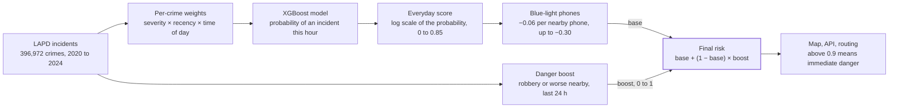

# SafeRoute risk scoring algorithm

*As of 2026-11-14.*

## Summary

Every 140 m tile within 5 miles of USC gets a risk score from 0 to 1 for each
hour of the day. Scores up to 0.85 describe everyday risk. Only a serious crime
against a person nearby in the last 24 hours can push a tile above 0.9, so that
range now means **immediate danger**.

- **Old scale:** a percentile rank, so 10% of all tile-hours sat above 0.9 and
  busy areas like DTLA and Koreatown were stuck at 1.0 all day.
- **New scale:** only 0.18% of 2023 tile-hours go above 0.9. The median
  tile-hour scores 0.39, and DTLA now reads about 0.76 at 10 pm instead of 1.0.
- **What did not change:** the model, its probabilities and its 2023 test AUC of
  0.849. The new scale is a different way of turning the same probability into
  a 0 to 1 number, plus a recent-danger term on top.

The code is in `algorithm/scoring/risk_scale.py` and `scoring/score.py`. Every
setting is in `common/config.py`.

## Pipeline

The score comes from two paths that meet at the end. The model turns each
tile's crime history into an everyday probability. Separately, any serious crime
in the last 24 hours adds a danger boost on top.

The top path is retrained when data or weights change. The bottom path and the
scale need no retraining, so they can be tuned freely.

## Tiles and coverage

The map is cut into H3 resolution-10 hexagons: about 140 m across, 80 m per
side and 0.017 km² each. The 5-mile circle around Tommy Trojan holds 12,081 of
them.

- **Modelled (10,152 tiles):** the tile's res-9 parent block (about 370 m
  across) had at least 5 LAPD incidents from 2020 to 2022. Coverage is judged on
  the larger block so a quiet LAPD residential street isn't mistaken for another
  jurisdiction.
- **No data (1,929 tiles):** mostly Vernon, Huntington Park, Inglewood's edge
  and county islands that LAPD doesn't police. They show grey and return
  `None`, meaning unknown, never safe.

The data is 396,972 LAPD incidents from 2020 to 2024 (dataset `2nrs-mtv8`). The
model trains on 2020 to 2022, is tested on 2023, and uses 2024 as an extra
check, because LAPD's switch to NIBRS halved the 2024 counts.

## Per-crime weights

Each past crime counts by how harmful it was, how recent it is, and how close
its hour is to the hour being scored:

$$
w = \text{severity} \times \frac{1}{1 + \text{age}_{\text{days}} / 3} \times \exp\left(-\frac{\Delta h^2}{2 \cdot 2^2}\right)
$$

**Severity (0 to 10)** follows the idea behind crime-harm indices such as the
Cambridge Crime Harm Index, weighted for a person walking in public. It is set
by LAPD crime code in `common/severity.py`.

| Severity | Crimes |
| --- | --- |
| 10 | homicide |
| 8 | rape and forcible sexual assault |
| 7 | kidnapping, human trafficking |
| 6 | shootings, aggravated assault |
| 5 | robbery |
| 4 | attempted robbery, sexual battery, brandishing a weapon |
| 3 | simple assault, theft from a person, criminal threats, arson |
| 2 | burglary, stalking, indecent exposure |
| 1 | vehicle crime, plain theft, felony vandalism, trespass |
| 0.5 | minor property and public-order offences, anything unlisted |
| 0.25 | fraud, identity theft, forgery |

A real weapon (LAPD codes 100 to 399: guns, knives, blunt objects) multiplies
severity by 1.5, capped at 6.

**Recency is log-scale:** $1 / (1 + \text{age} / 3\ \text{days})$. A crime from
yesterday counts 0.75, one from a month ago 0.09 and one from a year ago 0.008,
so yesterday's crime weighs about 8 times last month's and 90 times last
year's. The curve is fitted as a mix of 12 exponential decays, so the whole
history can be updated in one pass over the calendar.

**Time of day** uses a Gaussian with $\sigma = 2$ h. A crime 2 hours away from
the scored hour counts 0.61 and one 4 hours away counts 0.14, so a 10 pm score
mostly sees evening crimes.

These weights are summed per tile into `harm_recent` and `harm_recent_tod`, and
over the two rings of neighbouring tiles into `nb1_harm_recent` and
`nb2_harm_recent`.

## Model

An XGBoost classifier predicts the probability that at least one incident is
reported in a tile during a given hour on a given date. It reaches a 2023 test
AUC of 0.849, against 0.835 for a simple past-year count.

**Features (16).** All history features use only crimes from before the row's
date, so nothing leaks from the future.

| Group | Features |
| --- | --- |
| Time | hour, weekday, month, is_weekend, is_dark (from civil dawn and dusk) |
| Place | tile centre lat/lon, distance to the nearest of 83 USC blue-light phones |
| Weighted history | `harm_recent`, `harm_recent_tod`, `nb1_harm_recent`, `nb2_harm_recent` |
| Long-run counts | same hour ±1 over the past year, long-run rate, long-run rate at this hour |
| Area | incidents across the whole area in the last 7 days |

**Training.** Rows are tile × date × hour. Training keeps every row with an
incident plus 5 random rows without one, then corrects for that sampling so
outputs are real probabilities. It trains on 2020-04 to 2022-06 and early-stops
on 2022-07 to 2022-12 (depth 4, learning rate 0.03, 882 trees). The history
features and blue-light distance are monotone, so more crime can never lower a
score and moving away from a phone can never make a tile safer.

**Evaluation (2023, about 89M tile-hours, base rate 0.10%).** Negatives are
sampled and reweighted, so these are full-grid estimates.

| Model | ROC-AUC | PR-AUC | Top-10% capture |
| --- | --- | --- | --- |
| XGBoost | 0.849 | 0.0115 | 53.9% |
| sklearn GradientBoosting | 0.847 | 0.0094 | 53.4% |
| Past-year count at this hour | 0.835 | 0.0116 | 51.3% |

The 2024 check gives AUC 0.853, and calibration stays within 0.07 percentage
points in every decile. These numbers can't be compared with the old res-9
model's 0.746, because many small tiles never see a crime and are easy to rank.
Scored on the same res-9 blocks, res 10 gets 0.739 against res 9's 0.746. In
other words it is about as good at block level and adds detail inside each
block.

The features that matter most (mean |SHAP|) are the long-run rate (0.80),
`harm_recent` (0.42), hour (0.24) and `harm_recent_tod` (0.14).

## From probability to risk

The served score is built in three steps on top of the model's probability $p$.

1. **Everyday score (0 to 0.85).** The probability is placed on a log scale
   between two fixed anchors from the 2023 test year. The 5th-percentile
   probability ($p_{lo}$ = 0.0014%) maps to 0, and the 99.9th-percentile
   probability ($p_{hi}$ = 3.3%) maps to 0.85.

   $$
   \text{base} = 0.85 \times \operatorname{clip}\left(\frac{\ln(p / p_{lo})}{\ln(p_{hi} / p_{lo})},\ 0,\ 1\right),
   \qquad p_{lo} = 1.36 \times 10^{-5},\ p_{hi} = 0.0327
   $$

   Each 0.1 step in the score is about a 2.5× change in probability. The order
   of tiles is exactly the model's, but the gaps now reflect how much riskier
   one tile is than another.

2. **Blue-light phones: a linear drop.** Right after the everyday score is
   calculated, every USC emergency phone near the tile takes a fixed 0.06 off
   it. Each phone is weighted by distance (1 at the tile, 0.37 at 120 m, 0.08 at
   300 m), and the total drop is capped at 0.30:

   $$
   \text{drop} = \min\left(0.06 \sum_{i} e^{-d_i / 120\,\text{m}},\ 0.30\right),
   \qquad \text{base} \leftarrow \max(\text{base} - \text{drop},\ 0)
   $$

   where $d_i$ is the distance from the tile centre to phone $i$. The drop is
   linear in the number of phones, so phones compound: one phone right at the
   tile takes off 0.06, three take off 0.18, and five or more hit the 0.30 cap.

   | Phones within 150 m | Tiles | Average drop in score |
   | --- | --- | --- |
   | 0 (but within 300 m) | 47 | 0.07 |
   | 1 | 11 | 0.13 |
   | 2 to 4 | 29 | 0.23 |
   | 5 to 7 | 23 | 0.29 |
   | 8 or more | 12 | 0.30 |

   This is a policy choice, not something learned: phones sit where people
   already walk, so the data can't show their effect. The model also sees the
   distance to the nearest phone, with a monotone constraint so being farther
   from a phone can never raise a tile's safety. The drop is applied to the
   everyday score, before the danger boost, so a robbery right next to a phone
   still pushes the tile above 0.9.

3. **Danger boost (0 to 1).** Only serious crimes against a person count:
   severity 5 or higher, so robbery and worse. They must be from the last 24
   hours, in the tile (ring weight 1), an adjacent tile (0.5) or two tiles away
   (0.25). Each fades with a 6-hour time constant.

   $$
   x = \sum_{i} \frac{\text{severity}_i}{5} \cdot r_i \cdot e^{-\text{age}_{h,i} / 6},
   \qquad \text{boost} = 1 - e^{-x / 0.4}
   $$

The final score is

$$
\text{risk} = \text{base} + (1 - \text{base}) \times \text{boost}
$$

With base capped at 0.85, a tile only goes above 0.9 when the boost is at least
$\frac{0.9 - 0.85}{1 - 0.85} = 0.33$. Here is what a single crime does:

| Recent crime | Boost | Risk if base is 0.3 | Risk if base is 0.7 |
| --- | --- | --- | --- |
| None | 0 | 0.30 | 0.70 |
| Robbery in this tile, 1 h ago | 0.88 | 0.92 | 0.96 |
| Robbery in this tile, 6 h ago | 0.60 | 0.72 | 0.88 |
| Robbery in an adjacent tile, 1 h ago | 0.65 | 0.76 | 0.90 |
| Shooting in this tile, 30 min ago | 0.94 | 0.96 | 0.98 |

`explain_cell` now also returns `base`, the old `percentile` for reference, and
`danger` with the boost and the incidents behind it (how many hours ago, how
severe, which ring). The map shows the same breakdown when you hover a tile.

## How the new scale behaves on 2023 data

Every 2023 tile-hour was replayed through the new scale. The share above 0.9
fell from 10% to 0.18%, and higher bands still mean more crime.

| Score band | Share of tile-hours | Observed incident rate per hour |
| --- | --- | --- |
| 0 to 0.2 | 23.1% | 0.001% |
| 0.2 to 0.4 | 29.8% | 0.024% |
| 0.4 to 0.6 | 38.5% | 0.115% |
| 0.6 to 0.8 | 7.7% | 0.47% |
| 0.8 to 0.85 | 0.39% | 1.07% |
| 0.85 to 0.9 | 0.27% | 1.93% |
| Above 0.9 (danger) | 0.18% | 1.03% |

The percentiles of the score are 0.04 (10th), 0.39 (median), 0.59 (90th) and
0.78 (99th).

Some landmarks on the demo map (15 Dec 2023), with the old percentile score at
10 pm (before the new scale and the phone drop) for comparison:

| Place | New risk at 10 pm | Old score | 3 am | 2 pm |
| --- | --- | --- | --- | --- |
| DTLA, Pershing Square | 0.76 | 1.00 | 0.70 | 0.76 |
| Koreatown | 0.72 | 0.99 | 0.64 | 0.72 |
| Tommy Trojan (6 phones within 150 m) | 0.25 | 0.84 | 0.14 | 0.28 |
| Leimert Park | 0.53 | 0.84 | 0.41 | 0.54 |
| Figueroa and Adams | 0.42 | 0.58 | 0.30 | 0.39 |
| USC Village | 0.02 | 0.07 | 0.00 | 0.01 |

On that evening 17 tiles were above 0.9 at 10 pm. The top one, near 34.0086,
−118.3348, had a severity-6 crime (an aggravated assault, a shooting or an
armed robbery) in the tile half an hour earlier, which took it from an everyday
0.65 to 0.98.

**Two honest caveats:**

- **The danger range is a policy choice, not a forecast.** Tiles above 0.9 have
  a 1.03% incident rate, about 10 times the 0.10% average. But that is lower
  than the 0.85 to 0.9 band, because a busy tile with no fresh crime still sees
  more reports than a quiet tile that just had one. A recent serious crime does
  carry a little extra signal: tile-hours with a boost of 0.8 or more saw 0.62%
  incidents against 0.53% predicted.
- **Ranking accuracy dips slightly.** AUC on the served score is 0.841 against
  0.849 for the raw probability, because the boost lifts some quieter tiles
  above busier ones. Routing that wants pure prediction should use `prob`;
  routing that wants to steer around fresh incidents should use `risk`.

## Settings, limitations and next steps

Every number above is a setting in `common/config.py` or `common/severity.py`.
Changing the risk scale needs no retraining: rebuild the cache and the map.

| Setting | Value | What it does |
| --- | --- | --- |
| `RISK_BASE_MAX` | 0.85 | ceiling of the everyday score |
| `RISK_LO_QUANTILE`, `RISK_HI_QUANTILE` | 0.05, 0.999 | where the log-scale anchors sit (stored in `model_meta.json` as `risk_scale`) |
| `DANGER_MIN_SEVERITY` | 5 | lowest severity that can trigger the boost (robbery) |
| `DANGER_WINDOW_HOURS` | 24 | how far back the boost looks |
| `DANGER_TAU_HOURS` | 6 | how fast a crime's boost fades |
| `DANGER_RING_WEIGHTS` | 1, 0.5, 0.25 | weight of this tile, adjacent tiles, tiles two away |
| `DANGER_SCALE` | 0.4 | how quickly the boost saturates |
| `RECENCY_TAU_DAYS` | 3 | log-scale recency of the model features |
| `TOD_SIGMA_HOURS` | 2 | width of the time-of-day match |
| `BLUELIGHT_SCORE_DROP_PER_PHONE` | 0.06 | score taken off per nearby phone |
| `BLUELIGHT_SCORE_DROP_MAX` | 0.30 | the most that phones together can take off |
| `BLUELIGHT_RANGE_M` | 120 m | how fast a phone's weight fades with distance |

**Limitations**

- **No live feed.** LAPD's public data ends in December 2024 and lags by days.
  For today's date the boost is 0 everywhere, and history features stop at the
  end of 2023. That is why the demo map replays 15 Dec 2023. A real-time feed
  (for example LAPD calls for service) would plug into the boost without other
  changes.
- **Occurrence times are rough.** LAPD often logs unknown times as 12:00, and
  the boost treats an incident as happening at the middle of its logged hour.
- **Severity, the blue-light cut and the danger thresholds are design
  choices**, documented and tunable, not learned from data.

**Next steps:** use `risk` as the edge cost in the route planner, and look for a
near-real-time incident feed for the boost.
