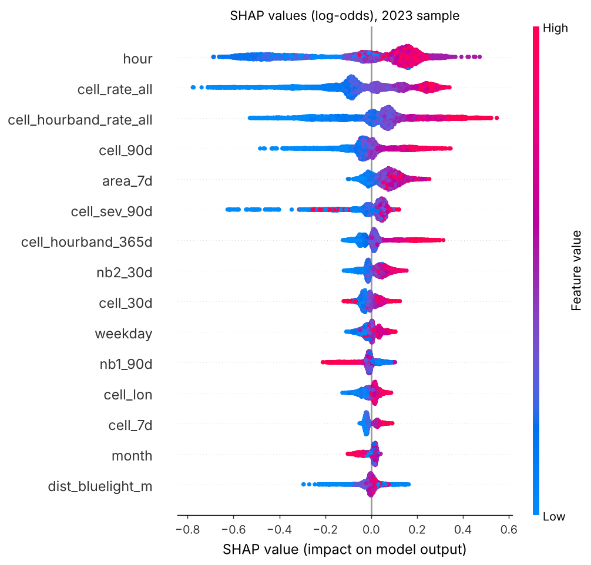

# SafeRoute crime-risk model: results

Model: XGBoost classifier on H3 res-9 cell × clock-hour × date rows, USC area
(116 cells, ~0.1 km² each). Target: at least one LAPD-reported incident in that
cell during that hour. Reproduce with `python -m models.train_xgb`; numbers
below come from `models/artifacts/metrics.json`.

## Out-of-time evaluation

Every metric is on the **full grid** for the year (every cell × hour × day, no
negative sampling), using data the model never trained on.

### 2023 test year (1,016,160 cell-hours, 7,438 with an incident, base rate 0.73%)

| Model | ROC-AUC | PR-AUC | Brier | Top-10% capture* |
|---|---|---|---|---|
| **XGBoost** | **0.686** | 0.0169 | **0.0072** | **27.9%** |
| sklearn GradientBoostingClassifier | 0.669 | 0.0139 | 0.0094 | 24.0% |
| Baseline: past-year count in cell at this hour ±1 | 0.674 | 0.0175 | n/a | 27.1% |

\* Share of all incident cell-hours that fall in the 10% of cell-hours the model ranks riskiest.

Heatmap-level check: averaging predictions per (cell, hour of day) over 2023 and
comparing with the observed incident count per slot gives a Spearman rank
correlation of **0.69**.

### 2024 extra check (1,018,944 cell-hours, base rate 0.47%)

| Model | ROC-AUC | PR-AUC | Top-10% capture |
|---|---|---|---|
| **XGBoost** | **0.722** | **0.0144** | **32.0%** |
| sklearn GradientBoostingClassifier | 0.676 | 0.0090 | 23.7% |
| Baseline (past-year count) | 0.705 | 0.0129 | 31.3% |

2024 has roughly half the reported volume after March because LAPD switched to
NIBRS reporting, so its base rate is lower. The model still ranks well there,
and it slightly over-predicts on average (0.61% predicted vs 0.47% observed).

## What this means

- Predicting whether a crime is reported in one 175 m hex in one specific hour
  is very noisy. PR-AUC is about 2.3× the base rate, and that is realistic for
  this granularity.
- XGBoost beats sklearn's GradientBoosting on every metric. It ranks about as
  well as a strong "same place, same hour, last year" heuristic, and adds three
  things the heuristic can't: **calibrated probabilities**, **per-score SHAP
  explanations**, and a place to plug in new signals (streetlights, weather,
  foot traffic).
- Calibration on 2023 is close to the diagonal across all ten deciles (see
  `calibration.png`). Predicted 0.19% → observed 0.14%, predicted 2.06% → observed 2.04%.

## Feature importance (mean |SHAP|, log-odds, 2023 sample)

1. `hour`: late afternoon through night raises risk, early morning lowers it
2. `cell_rate_all`: long-run incident rate in the cell
3. `cell_hourband_rate_all`: long-run rate in the cell at this hour ±1
4. `cell_90d`: recent 90-day count
5. `area_7d`: area-wide activity last week (also absorbs reporting-volume drift)

`is_dark` ranks low because `hour` already carries most of the light/dark
signal. The blue-light phone distance uses **placeholder** coordinates (see
README), so read its SHAP value with that in mind.

