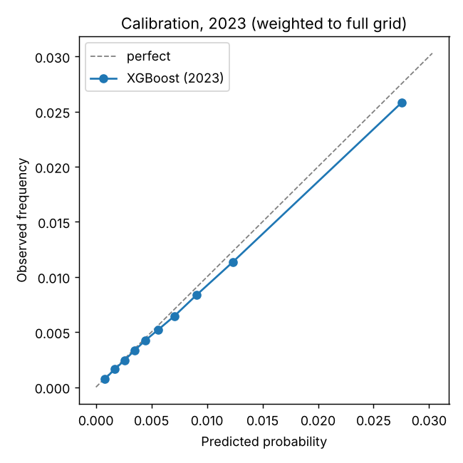

# SafeRoute crime-risk model: results

Model: XGBoost classifier on H3 res-9 cell × clock-hour × date rows, for the
**5-mile circle around USC**. Target: at least one LAPD-reported incident in
that cell during that hour. Reproduce with `python -m algorithm.models.train_xgb`.
The numbers below come from `models/artifacts/metrics.json`. For the full
walkthrough with plots, see `../explore_train_infer.ipynb`. For how to train
and call the model, see `../MODEL_GUIDE.md`.

## Area and data

- 1,724 H3 cells lie within 5 miles. **1,451 are modelled**, meaning they had
  at least 5 LAPD incidents in 2020–2022.
- The other 273 cells are mostly other jurisdictions (Vernon, Huntington Park,
  county islands). They are reported as `no_data`, never as safe.
- 396,972 incidents, 2020–2024. Training uses 2020-04 to 2022-12: 1.31M rows,
  with 219k positives plus 5 sampled negatives per positive.

## Per-crime weights

Every past crime counts `severity × 0.5^(age / half-life) × exp(−Δhour² / (2·2²))`:

- **Severity** is 0–10 by LAPD crime code (`common/severity.py`): homicide 10,
  rape 8, aggravated assault 6, robbery 5, simple assault 3, burglary 2,
  vehicle theft 1, fraud 0.25. A real weapon gives ×1.5, capped at 6.
- **Half-lives** are 7, 30 and 365 days, so recent crime dominates while the
  model still remembers chronic hotspots.
- **Time of day** uses σ = 2 h, so a 10 pm row mostly sees evening crimes.

**Blue-light phones** only lower risk. The model is monotone in
`dist_bluelight_m`, and scoring multiplies the probability by
`1 − 0.25·exp(−d/150 m)`.

## Out-of-time evaluation

The full 2023 grid has about 12.7M cell-hours. Evaluation keeps every
incident cell-hour plus 10 sampled negatives each, and weights the negatives
by 1/sample rate. Every metric below is therefore a **full-grid estimate**.
XGBoost numbers include the blue-light factor, as served by the API.

### 2023 test year (12.7M cell-hours, 87,530 with an incident, base rate 0.69%)

| Model | ROC-AUC | PR-AUC | Brier | Top-10% capture* |
|---|---|---|---|---|
| **XGBoost** | **0.746** | **0.0298** | 0.0068 | **36.7%** |
| sklearn GradientBoostingClassifier | 0.741 | 0.0258 | 0.0068 | 35.4% |
| Baseline: past-12-month count in cell at this hour ±1 | 0.734 | 0.0291 | n/a | 36.0% |

\* The share of all incident cell-hours that fall in the 10% of cell-hours the
model ranks riskiest.

Heatmap-level check: summing predictions per (cell, hour of day) over 2023 and
comparing them with observed counts gives a Spearman rank correlation of **0.72**.

Calibration stays close to the diagonal in every decile. For example, a
predicted 0.08% came out as 0.075% observed, and a predicted 2.75% came out as
2.58% observed.

### 2024 extra check (12.7M cell-hours, base rate 0.36%)

| Model | ROC-AUC | PR-AUC | Top-10% capture |
|---|---|---|---|
| **XGBoost** | **0.766** | **0.0210** | **40.5%** |
| sklearn GradientBoostingClassifier | 0.748 | 0.0165 | 36.7% |
| Baseline | 0.750 | 0.0206 | 39.4% |

In 2024 the model over-predicts on average (0.57% predicted vs 0.36%
observed). This is expected: the 2024 drop is LAPD's NIBRS reporting change,
not less crime.

## What changed vs the 10-mile model

- The area shrank from 10 to 5 miles, and AUC went from 0.785 to 0.746. The
  smaller area has fewer very different places to tell apart, so ranking
  inside it is harder. The old feature set on the same 5-mile data scores
  0.747, so the drop comes from the area, not the new features.
- The ad hoc violent/property counts were replaced by per-crime weights
  (severity × recency × time of day): 18 features instead of 21.
- Blue-light phones now have an explicit protective effect.

## Feature importance (mean |SHAP|, log-odds, 2023 grid-weighted sample)

1. `cell_rate_all`: the cell's long-run incident rate
2. `cell_hourband_rate_all`: the cell's long-run rate at this hour ±1
3. `hour`: time of day
4. `harm_30d_tod`, `harm_365d_tod`, `harm_30d`, `harm_7d`: the per-crime
   weighted history. Together they carry slightly more weight than `hour`.

The notebook (`../explore_train_infer.ipynb`, section 8) runs six score sanity
checks on this saved model. All of them pass:
- Known dangerous places beat quiet residential blocks at every hour, by about 32× in probability.
- The cells with the most severity-weighted harm beat the quietest cells at every hour.
- Predicted vs actual 2023 incidents per cell: Spearman 0.96.
- Risk never goes down as any history feature grows.
- Moving a blue-light phone closer never raises risk.
- Each cell's predicted hour-of-day shape matches its own history: median ρ 0.74, and every night-heavy cell is predicted night-heavy.

## Caveats

- **Saturation:** `risk` is a percentile over the whole 5-mile area, so busy
  areas such as downtown, MacArthur Park and Koreatown sit at or near 1.0 all
  day. To compare blocks inside a busy area, use `prob`.
- Severity scores, half-lives and the blue-light cut are design choices
  documented in `common/severity.py` and `common/config.py`, not learned from data.

